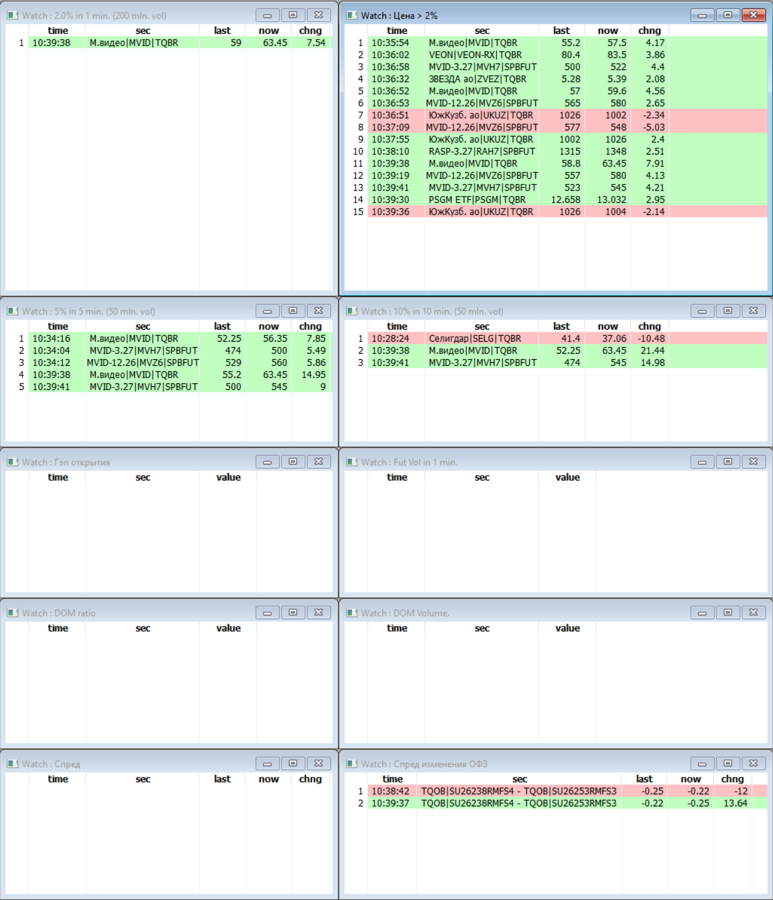
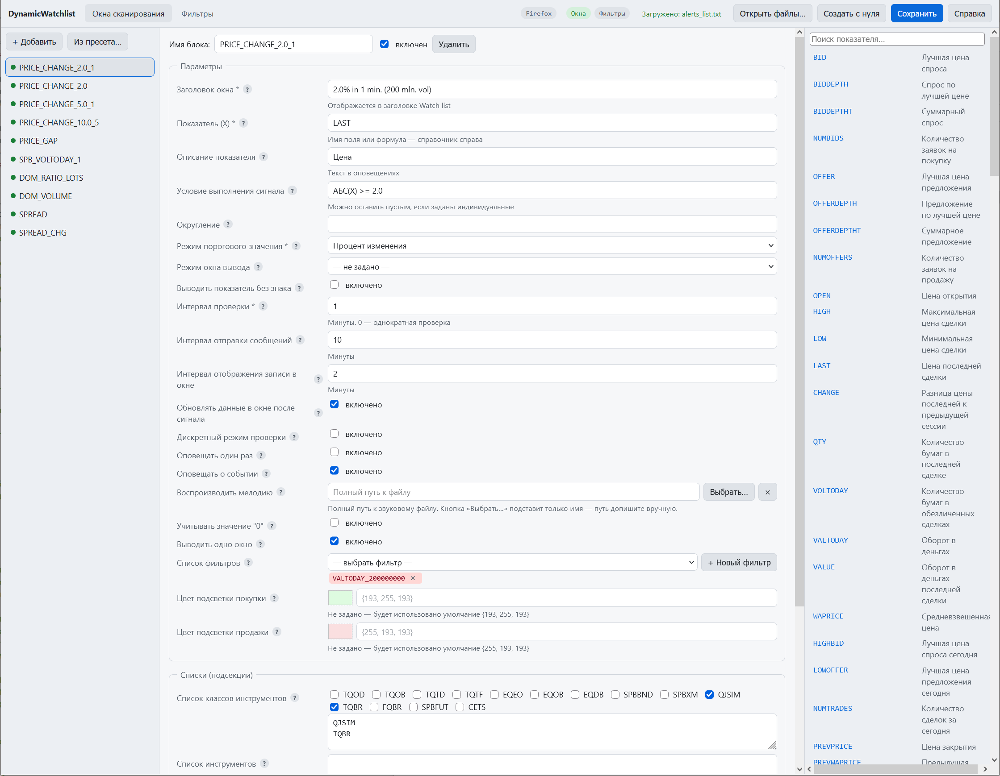
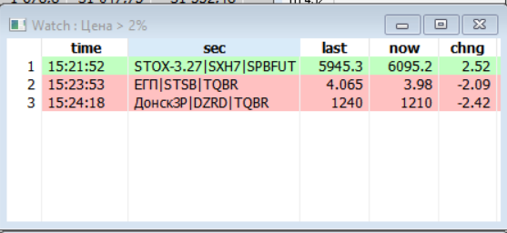
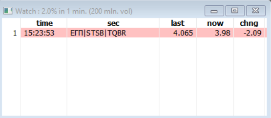
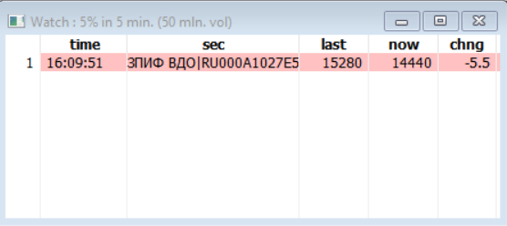
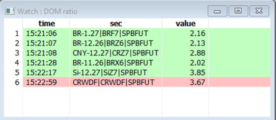
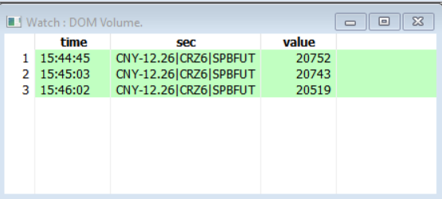

Скрипт для сканирования данных таблицы текущих торгов по спискам финансовых инструментов, который автоматически обновляется на основе заданных пользователем критериев.
Скрипт показывает отдельные окна на каждый заданный критерий. При выполнении критерия, например цена инструмента изменилась более чем на заданный порог, в окне появится запись,
а также, если задано, отправлено сообщение, воспроизведена мелодия. По истечении заданного времени запись из окна исчезает. Т.о. сигналы появляются и очищаются.
Можно задать разные окна по разным критериям. Примеры таких окон описаны ниже.

По вопросам приобретения данного скрипта обращайтесь.

# Dynamic Watchlist — руководство по файлам настроек

Полное описание параметров, формата и примеров для `alerts_list.txt` и `filters_list.txt`.

## Содержание

1. [Введение](#1-введение)
2. [Формат файлов](#2-формат-файлов)
3. [Параметры окна сканирования](#3-параметры-окна-сканирования)
4. [Подсекции окна](#4-подсекции-окна)
5. [Язык формул](#5-язык-формул)
6. [Фильтры](#6-фильтры)
7. [Окна типа SPREAD](#7-окна-типа-spread)
8. [Готовые примеры](#8-готовые-примеры)
9. [Типичные ошибки](#9-типичные-ошибки)
10. [Сохранение](#10-сохранение)
11. [Кодировка и .bak](#11-кодировка-и-bak)

---

## 1. Введение

Скрипт **Dynamic Watchlist** сканирует таблицу текущих торгов и выводит сигналы в окна Watch list.

После запуска скрипт формирует динамические окна вывода информации. Каждое окно это раздел в файле настроек, оно формирует сигналы на основе заданных условий, фильтров и критериев.

Пример:




Т.к. каждое окно сканирует все инструменты исходя из заданных классов, инструментов, то стоит ограничивать как минимум классы бумаг.
Например, если требуется контролирвать акции, то указать класс TQBR, фьючерсы - SPBFUT.
Если не указать ни один фильтр, то окно будет сканировать все доступные бумаги, даже информационный класс. Что сильно увеличит нагрузку на передачу данных с сервера брокера.
Если сканируется класс с большим числом бумаг, например опционов SPBOPT или даже фьючерсов, то также рекомендуется также указывать фильтры бумаг.
Например только RI, Si, Br и т.д. А по по опционам еще и страйки и сроки.

Поведение задаётся двумя файлами:

- `alerts_list.txt` — **окна сканирования**: что контролировать, при каком условии срабатывать, как отображать.
- `filters_list.txt` — **фильтры**: предварительный отбор инструментов по объёму, изменению и т.п.

Редактор `editor.html` — визуальная оболочка для этих двух файлов. Он читает файлы, позволяет править поля через формы, проверяет данные и записывает обратно в том же формате. **Рекомендуется использовать редактор** — он исключает опечатки в именах параметров и языковых конструкциях.




Третий файл, `DynamicWatchlist_params.txt`, задаёт глобальные параметры скрипта (время, отправка сообщений, звук, лог). Он редко меняется и правится вручную — в редакторе он не показывается.

> **Примечание.** Если вы правите файл вручную — открывайте его в кодировке **cp1251**. Иначе кириллица в ключах параметров будет нечитаемой, и скрипт их не распознает.

---

## 2. Формат файлов

### Общая структура

Файл состоит из блоков. Каждый блок начинается с имени в квадратных скобках:

```txt
[PRICE_CHANGE_2]
Заголовок окна: 2% за 1 мин.
Показатель (X): LAST
Условие выполнения сигнала: АБС(X) >= 2.0
Интервал проверки: 1
[[Список классов инструментов]]
TQBR
```

### Правила

- **Имя блока** — латиница, цифры, символы `_`, `.`, `-`. Внутри одного файла имена уникальны.
- **Разделитель параметра** — двоеточие `:`. До двоеточия — имя параметра, после — значение. Пробелы вокруг двоеточия допустимы.
- **Подсекция** — двойные квадратные скобки: `[[Имя подсекции]]`. После неё идут значения, по одному в строке.
- **Пустая строка** закрывает текущую подсекцию: следующая строка снова относится к параметрам блока или к новой подсекции.
- **Комментарии** — строки, начинающиеся с `;`. Редактор их не пишет при сохранении, но при ручном редактировании они безвредны.
- **Отключённый блок** — если имя блока закомментировано (`; [NAME]`), блок считается выключенным: скрипт его не исполняет, но и не забывает — при сохранении из редактора он останется с `;`.

> **Внимание.** Значение параметра может содержать двоеточие — например, формула `АБС(X) >= 2.0` пишется после первого `:`. Редактор и скрипт берут первое двоеточие как разделитель, остальное — значение.

---

## 3. Параметры окна сканирования

Все параметры необязательны, кроме отмеченных **★**. Если параметр не задан — действует значение по умолчанию, указанное в описании.

### Заголовок окна *(строка ★)*

Заголовок создаваемого окна Watch list. Одно-двухсловное описание — например «2% за 1 мин», «Спред», «Объём фьючерсов».

### Показатель (X) *(формула ★)*

Что контролируем. Может быть именем поля из таблицы текущих торгов (`LAST`, `VOLTODAY`, `DOM_RATIO_LOTS`) либо арифметической формулой из этих полей.

Примеры: `LAST` · `VOLTODAY/LOTSIZE` · `(OPEN-PREVPRICE)*100/PREVPRICE`

### Описание показателя *(строка)*

Текст, который выводится в оповещениях рядом со значением. Например «Цена», «Объём», «Гэп открытия».

### Условие выполнения сигнала *(формула ★)*

Формула проверки значения `X`. Символ `X` — это результат, вычисленный по полю «Показатель (X)».

Примеры: `АБС(X) >= 2.0` · `X < 0` · `X >= 10000` · `X < -2 ИЛИ X > 2`

Подробно про операторы — раздел [«Язык формул»](#5-язык-формул).

### Округление *(число)*

Сколько знаков после запятой оставить у вычисленного показателя. Не задано — без округления.

### Режим порогового значения *(перечисление ★)*

Что именно проверяет `X` в условии:

- **Процент изменения** — процент изменения показателя от начала интервала. Например, `LAST` вырос на 2% — `X = 2`.
- **Изменение** — абсолютная разница показателя от начала интервала (в единицах). Например, `VOLTODAY` увеличился на 10 000 лотов.
- **Значение показателя** — сам показатель, без сравнения с прошлым. Используется для контроля уровня: `VOLTODAY >= 10000`, `LAST >= 250`.

### Режим окна вывода *(перечисление)*

Колонки окна Watch list:

- **Изменение** (по умолчанию) — `time`, `sec`, `last`, `now`, `chng`: время, инструмент, значение в начале периода, текущее значение, изменение.
- **Только значение** — `time`, `sec`, `value`: время, инструмент, текущее значение. Для контроля абсолютных уровней (объём, соотношение стакана).

### Выводить показатель без знака *(Да/Нет)*

Отрицательные значения показывать как положительные. Имеет смысл, когда сигналы BUY и SELL выводятся в разных окнах, и знак не нужен — например, для `DOM_RATIO`, где в окне BUY используется BID/ASK, в SELL — ASK/BID.

### Интервал проверки *(минуты ★)*

Период, за который измеряется изменение показателя или в течение которого проверяется достижение уровня.

- **> 0** — циклическая проверка: каждые N минут начинается новый период.
- **0** — однократная проверка: сигнал срабатывает один раз при первом выполнении условия, дальше контроль не повторяется.

### Интервал отправки сообщений *(минуты)*

Как часто отправлять оповещения по одному и тому же сигналу. Можно указать больше интервала проверки — это снижает поток сообщений по одному инструменту.

### Интервал отображения записи в окне *(минуты)*

Сколько минут строка остаётся в окне Watch list после сигнала. По истечении — исчезает.

### Обновлять данные в окне после сигнала *(Да/Нет)*

Если после срабатывания значение ещё сильнее превысило порог — обновлять строку в окне. Имеет смысл только когда **дискретный режим выключен**.

### Дискретный режим проверки *(Да/Нет)*

Проверять показатель только в двух точках — в начале и в конце интервала. Сравнивается состояние «на старте» и «на финише».

Если выключен — сравнение идёт непрерывно в течение интервала: сигнал сработает, даже если порог был превышен в середине, а к концу интервала показатель вернулся в норму.

### Оповещать один раз *(Да/Нет)*

Проверять показатель до первого срабатывания. После сигнала контроль прекращается. Используется для одноразового оповещения — например, о гэпе при открытии.

### Оповещать о событии *(Да/Нет)*

Отправлять ли оповещение при срабатывании. Если «Нет» — сигнал только выводится строкой в окне Watch list. Каналы доставки (email, telegram, звук) настраиваются в `DynamicWatchlist_params.txt`.

### Воспроизводить мелодию *(путь к файлу)*

Звуковой файл, который проигрывается при срабатывании. Указывается полный путь. Если параметр не задан — звук не играет.

Пример: `C:\Windows\Media\Ring01.wav`

### Учитывать значение "0" *(Да/Нет)*

Как воспринимать нулевое значение показателя. Обычно ноль означает отсутствие данных (нет сделок, пустой стакан) — тогда его надо пропускать.

- **Нет** (по умолчанию) — ноль игнорируется.
- **Да** — ноль участвует в проверке.

### Выводить одно окно *(Да/Нет)*

По умолчанию формируются два окна: BUY (рост, положительные изменения) и SELL (падение, отрицательные). Если включить — всё в одном окне. Имеет смысл для показателей, у которых направление не важно (объём, соотношение стакана).

### Список фильтров *(список)*

Имена фильтров из `filters_list.txt`, применённых к инструментам этого окна. Разделитель — `|`. Инструмент попадает в окно, только если прошёл все указанные фильтры.

Пример: `VALTODAY_200000000|GROW_TODAY`

### Цвет подсветки покупки *(RGB)*

Фон строки для положительного сигнала. Формат: `{R, G, B}`, каждый канал 0–255.

Умолчание, если не задано: `{193, 255, 193}` — светло-зелёный.

### Цвет подсветки продажи *(RGB)*

Фон строки для отрицательного сигнала.

Умолчание, если не задано: `{255, 193, 193}` — светло-красный.

---

## 4. Подсекции окна

Подсекции задают списки инструментов, классов, пар и индивидуальных условий. Каждая — необязательна; если подсекции нет — действует правило по умолчанию.

### [[Список классов инструментов]]

Ограничивает сканирование конкретными классами. Если не указан — используются классы из `DynamicWatchlist_params.txt`.

```txt
[[Список классов инструментов]]
TQBR
SPBFUT
```

Доступные классы: `TQOD`, `TQOB`, `TQTD`, `TQTF`, `EQEO`, `EQOB`, `EQDB`, `SPBBND`, `SPBXM`, `QJSIM`, `TQBR`, `FQBR`, `SPBFUT`, `CETS`.

### [[Список инструментов]]

Ограничивает набор инструментов. Формат строки: `CLASS|CODE`. Если не указан — сканируются все инструменты выбранных классов.

```txt
[[Список инструментов]]
TQBR|SBER
TQBR|GAZP
SPBFUT|RIZ6
```

**Маски** позволяют задавать группы:

- `*` — любая последовательность символов;
- `%d` — цифра; `%a` — буква; `%w` — буква или цифра;
- `+` — один или несколько предыдущих символов.

```txt
SPBFUT|RI*              все инструменты, начинающиеся на RI
SPBFUT|*U3              все инструменты, заканчивающиеся на U3
SPBOPT|BR*BF3           начинаются на BR и заканчиваются на BF3
SPBFUT|%d%d%d           код из трёх цифр
```

### [[Список исключений инструментов]]

Исключает инструменты из сканирования. Синтаксис тот же, что у «Списка инструментов».

```txt
[[Список исключений инструментов]]
SPBFUT|CRWDF
```

### [[Список пар]] — формулы по нескольким инструментам

Используется в окнах типа SPREAD (см. [раздел 7](#7-окна-типа-spread)). В отличие от простого «Списка инструментов», здесь **каждая строка — арифметическое выражение из инструментов**. Скрипт подбирает сочетания инструментов по маскам и для каждого сочетания вычисляет формулу. Результат подставляется в условие как `X`.

```txt
[[Список пар]]
SPBFUT|CR* - SPBFUT|CR*
(SPBFUT|CR* - SPBFUT|CR*)/(SPBFUT|CR* + SPBFUT|CR*)
1000*(SPBFUT|CR*) - SPBFUT|CNYRUBF
(SPBFUT|CR* - SPBFUT|CR*)/(SPBFUT|RI*)
```

Поддерживаются: `+`, `-`, `*`, `/`, скобки, числа-коэффициенты. Инструменты указываются в форме `CLASS|CODE` с масками.

### [[Индивидуальные условия выполнения сигнала]]

Позволяет задать **своё условие** для конкретного инструмента или набора. Формат: `селектор: условие`.

```txt
[[Индивидуальные условия выполнения сигнала]]
SPBFUT|RI*: X >= 2000
SPBFUT|CRZ6 - SPBFUT|CRH7: АБС(X) >= 0.5
```

Если для инструмента (или пары) есть индивидуальное условие — используется оно. Иначе — основное «Условие выполнения сигнала» из параметров окна.

---

## 5. Язык формул

Формулы используются в трёх местах: **Показатель (X)**, **Условие выполнения сигнала**, **[[Список пар]]**. Синтаксис единый.

### Операторы

| Оператор | Назначение |
|---|---|
| `+ - * /` | арифметические действия |
| `( )` | группировка, скобки |
| `> >= < <= = <>` | сравнения |
| `И` | логическое «и» |
| `ИЛИ` | логическое «или» |
| `АБС(x)` | абсолютное значение (модуль) |
| `ЛОГ(x)` | логарифм |

### Значение X

В условии символ `X` — это значение поля «Показатель (X)». Например, при `Показатель (X): LAST` и `Режим: Процент изменения` символ X равен проценту изменения цены за интервал.

### Примеры условий

- `X >= 10000` — значение не меньше 10 000.
- `X < 0` — отрицательное значение (например, цена ниже вчерашней).
- `АБС(X) >= 2.0` — изменение на 2% в любую сторону.
- `X <= -2 ИЛИ X >= 2` — то же, что выше, через два условия.
- `X > 100 И X < 150` — значение в диапазоне.
- `X < -0.235 ИЛИ X > 0.345` — вне диапазона.
- `ЛОГ(X) > 1` — по логарифму.

---

## 6. Фильтры

Фильтры отсеивают неликвид и неподходящие инструменты **до** того, как окно начнёт по ним работать. Файл — `filters_list.txt`. Синтаксис тот же, что у окон: блок, параметры через `:`.

### Показатель (X) *(формула ★)*

Имя показателя, который фильтруем.

Пример: `VALTODAY` · `CHANGE` · `VOLTODAY`

### Условие выполнения сигнала *(формула ★)*

Условие прохождения фильтра. Если выполняется — инструмент допускается к сканированию.

Пример: `X >= 50000000` — оборот не меньше 50 млн ₽.

### Запоминать признак выполнения фильтра *(Да/Нет)*

Проверять ли условие один раз. Если «Да» (по умолчанию) — после первого успешного прохождения инструмент считается прошедшим и повторно не проверяется до конца сессии. Для «Да» используйте в условиях стабильные показатели (объём за день, оборот), которые не «откатываются» назад.

Если нужно, чтобы инструмент «вылетал» из окна при невыполнении условия (например, оборот упал) — ставьте «Нет».

### Использование в окне

```txt
Список фильтров: VALTODAY_200000000|GROW_TODAY
```

Инструмент попадёт в окно, только если прошёл все перечисленные фильтры одновременно.

---

## 7. Окна типа SPREAD

Если в блоке есть подсекция `[[Список пар]]`, скрипт считает не сам показатель одного инструмента, а **арифметическое выражение из показателей нескольких инструментов**. Такие окна удобны для арбитража, контроля спредов, соотношений и синтетических индексов.

### Как это работает

1. В **Показатель (X)** указывается имя показателя — например `LAST`.
2. В **[[Список пар]]** — формула из инструментов (с масками). Скрипт подбирает сочетания инструментов по маскам.
3. Для каждого сочетания вычисляется формула. Результат — `X`.
4. `X` проверяется в **Условии выполнения сигнала**, как обычно.

### Примеры формул

- `SPBFUT|CR* - SPBFUT|CR*` — простая разница между двумя инструментами.
- `(SPBFUT|CR* - SPBFUT|CR*)/(SPBFUT|CR* + SPBFUT|CR*)` — относительная разница.
- `1000*(SPBFUT|CR*) - SPBFUT|CNYRUBF` — со скейлом: разница между фьючерсом × 1000 и курсом CNYRUBF.
- `(SPBFUT|CR* - SPBFUT|CR*)/(SPBFUT|RI*)` — нормировка разницы на другой инструмент.

### Индивидуальные условия для конкретных пар

Если для разных пар нужны разные пороги — задайте их в `[[Индивидуальные условия выполнения сигнала]]`:

```txt
[[Индивидуальные условия выполнения сигнала]]
SPBFUT|CRZ6 - SPBFUT|CRH7: АБС(X) >= 0.5
(SPBFUT|CRZ6 - SPBFUT|CRH7)/SPBFUT|CRH7: X >= 0.01
```

> **Проверяйте формулы.** Формулы должны быть алгебраически корректны: сбалансированные скобки, числа перед знаками операций. Редактор проверяет базовые ошибки (наличие `|` — признак инструмента, баланс скобок), но полную корректность — на совести пользователя.

---

## 8. Готовые примеры

### Изменение цены






```txt
; Пример блока сканирования изменения цены инструмента на 2% процента, за 1 минуту.
; Контролируется только класс TQBR
; Фильтр - Проторгованный Объем > 200 млн. рублей.
[PRICE_CHANGE_2.0_1]
Заголовок окна : 2.0% in 1 min. (200 mln. vol)
Показатель (X) : LAST
Описание показателя : Цена
Условие выполнения сигнала : АБС(X) >= 2.0
Режим порогового значения : Процент изменения
Интервал проверки : 1
Интервал отправки сообщений : 10
Интервал отображения записи в окне : 2
Обновлять данные в окне после сигнала : 1
Дискретный режим проверки : 0
Оповещать один раз : 0
Оповещать о событии : 1
Учитывать значение "0" : 0
Выводить одно окно : 1
Список фильтров : VALTODAY_200000000
[[Список классов инструментов]]
QJSIM
TQBR

; Пример блока сканирования изменения цены инструмента на 5% процентов, за 5 минут.
; Контролируется только класс TQBR
; Фильтр - Проторгованный Объем > 50 млн. рублей.
[PRICE_CHANGE_5.0_1]
Заголовок окна : 5% in 5 min. (50 mln. vol)
Показатель (X) : LAST
Описание показателя : Цена
Условие выполнения сигнала : АБС(X) >= 5.0
Режим порогового значения : Процент изменения
Интервал проверки : 5
Интервал отправки сообщений : 10
Интервал отображения записи в окне : 10
Обновлять данные в окне после сигнала : 1
Дискретный режим проверки : 0
Оповещать один раз : 0
Оповещать о событии : 1
Учитывать значение "0" : 0
Выводить одно окно : 1
Список фильтров : VALTODAY_50000000
[[Список классов инструментов]]
QJSIM
TQBR

; Пример блока сканирования изменения цены инструмента на 10% процентов, за 10 минут.
; Контролируется только класс TQBR
; Фильтр - Проторгованный Объем > 50 млн. рублей.
[PRICE_CHANGE_10.0_5]
Заголовок окна : 10% in 10 min. (50 mln. vol)
Показатель (X) : LAST
Описание показателя : Цена
Условие выполнения сигнала : АБС(X) >= 10.0
Режим порогового значения : Процент изменения
Интервал проверки : 10
Интервал отправки сообщений : 20
Интервал отображения записи в окне : 20
Обновлять данные в окне после сигнала : 1
Дискретный режим проверки : 0
Оповещать один раз : 0
Оповещать о событии : 1
Учитывать значение "0" : 0
Выводить одно окно : 1
Список фильтров : VALTODAY_50000000
[[Список классов инструментов]]
QJSIM
TQBR
```

### Гэп открытия (больше 2% в любую сторону)

```txt
; Пример блока сканирования гепов при открытии.
; Фильтр на не нулевой объём, чтобы исключить технические 100% гэпы
; Контролируется только класс TQBR
[PRICE_GAP]
Заголовок окна : Гэп открытия
Показатель (X) : (OPEN - PREVPRICE)*100/PREVPRICE
Описание показателя : Геп открытия
Условие выполнения сигнала : АБС(X) >= 2.0
Округление : 2
Режим порогового значения : Значение показателя
Режим окна вывода : Только значение
Интервал проверки : 0
Интервал отправки сообщений : 10
Интервал отображения записи в окне : 10
Обновлять данные в окне после сигнала : 0
Дискретный режим проверки : 0
Оповещать один раз : 1
Оповещать о событии : 1
Учитывать значение "0" : 0
Выводить одно окно : 1
Список фильтров : VALTODAY_1
[[Список классов инструментов]]
QJSIM
TQBR
[[Список инструментов]]
TQBR|SBER
TQBR|GAZP
```

`Интервал проверки: 0` — проверка один раз за день. `Оповещать один раз: 1` — после срабатывания контроль отключается.

### Изменения объема инструмента

```txt
; Пример блоков сканирования изменения объема инструмента болеее 60000 лотов, за день.
; Значение показателя задано как формула VOLTODAY - Проторгованный Объем в руб.
; Фильтры по росту, падению
; Контролируется только классы TQBR
; Указан список инструментов для сканирования
[GROW_VOLTODAY_1DAY]
Заголовок окна : Vol in day|Grow.
Показатель (X) : VOLTODAY
Описание показателя : Объем
Пороговое значение показателя : X >= 60000
Режим порогового значения : Абсолютное значение
Режим окна вывода : Только значение
Интервал проверки : 1440
Интервал отправки сообщений : 1440
Интервал отображения записи в окне : 1440
Обновлять данные в окне после сигнала : 1
Дискретный режим проверки : 0
Оповещать один раз : 1
Оповещать о событии : 1
Учитывать значение "0" : 0
Выводить одно окно : 1
Список фильтров : VALTODAY_50000000|GROW_TODAY
[[Список классов инструментов]]
QJSIM
TQBR

[FALL_VOLTODAY_1DAY]
Заголовок окна : Vol in day|Fall.
Показатель (X) : VOLTODAY
Описание показателя : Объем
Пороговое значение показателя : X >= 60000
Режим порогового значения : Абсолютное значение
Режим окна вывода : Только значение
Интервал проверки : 1440
Интервал отправки сообщений : 1440
Интервал отображения записи в окне : 1440
Обновлять данные в окне после сигнала : 1
Дискретный режим проверки : 0
Оповещать один раз : 1
Оповещать о событии : 1
Учитывать значение "0" : 0
Выводить одно окно : 1
Цвет подсветки : {255, 193, 193}
Список фильтров : VALTODAY_50000000|FALL_TODAY
[[Список классов инструментов]]
QJSIM
TQBR
```

### Объём фьючерсов за 1 минуту

```txt
; Пример блока сканирования изменения объема инструмента болеее 10000 контрактов, за 1 минуту для срочного рынка
; Значение показателя задано как формула VOLTODAY - Количество контрактов в обезличенных сделках.
; Контролируется только классы SPBFUT
; Указан список инструментов для сканирования
; Указаны индивидуальные значения для инструментов класса SPBFUT
[SPB_VOLTODAY_1]
Заголовок окна : Fut Vol in 1 min.
Показатель (X) : VOLTODAY
Описание показателя : Объем
Условие выполнения сигнала : X >= 10000
Режим порогового значения : Изменение
Режим окна вывода : Только значение
Интервал проверки : 1
Интервал отправки сообщений : 5
Интервал отображения записи в окне : 5
Обновлять данные в окне после сигнала : 1
Дискретный режим проверки : 0
Оповещать один раз : 0
Оповещать о событии : 1
Учитывать значение "0" : 0
Выводить одно окно : 1
[[Список классов инструментов]]
SPBFUT
[[Список инструментов]]
SPBFUT|RI*
SPBFUT|Si*
SPBFUT|BR*
SPBFUT|SR*
SPBFUT|CR*
[[Индивидуальные условия выполнения сигнала]]
SPBFUT|RI* : X >= 2000
SPBFUT|Si* : X >= 50000
SPBFUT|BR* : X >= 4000
SPBFUT|SR* : X >= 7000
SPBFUT|CR* : X >= 70000
```

### Соотношение стакана (DOM_RATIO)




```txt
; Пример блока сканирования показателя соотношения данных "стакана" DOM_RATIO, рассчитанный как BID/ASK для BUY и ASK/BID для SELL за 60 минут.
; Показатель расчете LOTS - объем в лотах. Полное имя показателя DOM_RATIO_LOTS. Также доступен параметр DOM_RATIO_ORDERS - контролировать соотношение выставленных заявок.
; Контролируется только классы TQBR и SPBFUT
; Указан список инструментов для сканирования
; Указаны индивидуальные значения для инструментов класса SPBFUT
; В данном примере контролируется что если в течении 60 минут BID/ASK или ASK/BID превысит порог, то выводится сообщение.
; В следующие 60 минут начинается очередной цикл контроля.
[DOM_RATIO_LOTS]
Заголовок окна : DOM ratio
Показатель (X) : DOM_RATIO_LOTS
Условие выполнения сигнала : АБС(X) >= 2.0
Режим порогового значения : Значение показателя
Режим окна вывода : Только значение
Выводить показатель без знака : 1
Интервал проверки : 60
Интервал отправки сообщений : 60
Интервал отображения записи в окне : 60
Обновлять данные в окне после сигнала : 0
Дискретный режим проверки : 0
Оповещать один раз : 0
Оповещать о событии : 1
Учитывать значение "0" : 0
Выводить одно окно : 1
[[Список классов инструментов]]
QJSIM
TQBR
SPBFUT
[[Список инструментов]]
SPBFUT|RI*
SPBFUT|Si*
SPBFUT|BR*
SPBFUT|SR*
SPBFUT|CR*
TQBR|SBER
TQBR|GAZP
[[Индивидуальные условия выполнения сигнала]]
TQBR|SBER: АБС(X) >= 1.5
TQBR|GAZP: АБС(X) >= 1.5
```

### Объем в стакане (DOM_VOLUME)



```txt
; Пример блока сканирования показателя объёма в "стакане" DOM_VOLUME за 1 минут.
; Контролируется только классы SPBFUT
; Указан список инструментов для сканирования
; Указаны индивидуальные значения для инструментов класса SPBFUT
; В данном примере контролируется что если в течении 1 минуты объём на стороне BID или ASK превысит порог, то выводится сообщение.
; В следующую минуту начинается очередной цикл контроля.
[DOM_VOLUME]
Заголовок окна : DOM Volume.
Показатель (X) : DOM_VOLUME_LOTS
Описание показателя : Объем
Условие выполнения сигнала : X >= 10000
Режим порогового значения : Значение показателя
Режим окна вывода : Только значение
Выводить показатель без знака : 1
Интервал проверки : 1
Интервал отправки сообщений : 5
Интервал отображения записи в окне : 5
Обновлять данные в окне после сигнала : 1
Дискретный режим проверки : 0
Оповещать один раз : 0
Оповещать о событии : 1
Учитывать значение "0" : 0
Выводить одно окно : 1
[[Список классов инструментов]]
SPBFUT
[[Список инструментов]]
SPBFUT|RI*
SPBFUT|Si*
SPBFUT|BR*
SPBFUT|SR*
SPBFUT|CR*
[[Индивидуальные условия выполнения сигнала]]
SPBFUT|RI* : X >= 2000
SPBFUT|Si* : X >= 5000
SPBFUT|BR* : X >= 5000
SPBFUT|SR* : X >= 5000
SPBFUT|CR* : X >= 20000
```

### Спред между фьючерсами CR

```txt
; Пример блока сканирования разницы между ценой одного инструмента и другого.
; Контролируется только классы SPBFUT
; Указан список пар инструментов для сканирования
; Указаны индивидуальные значения для инструментов класса SPBFUT
; В данном примере контролируется что если в течении 1 минуты разница цен (спред) измениться больше чем на 2%, то выводится сообщение.
; В следующую минуту начинается очередной цикл контроля.
[SPREAD]
Заголовок окна: Спред
Показатель (X): LAST
Описание показателя: Цена
Условие выполнения сигнала: АБС(X) >= 2.0
Режим порогового значения: Процент изменения
Интервал проверки: 1
Интервал отправки сообщений: 10
Обновлять данные в окне после сигнала: 1
Оповещать о событии: 1
Выводить одно окно: 1
Список фильтров: VALTODAY_200000000
[[Список классов инструментов]]
SPBFUT
[[Список исключений инструментов]]
SPBFUT|CRWDF
[[Список пар]]
SPBFUT|CR* - SPBFUT|CR*
[[Индивидуальные условия выполнения сигнала]]
SPBFUT|CRZ6 - SPBFUT|CRH7: АБС(X) >= 0.5
```

### Фильтры (filters_list.txt)

```txt
[VALTODAY_200000000]
Показатель (X): VALTODAY
Условие выполнения сигнала: X >= 200000000
Запоминать признак выполнения фильтра: 1

[VALTODAY_50000000]
Показатель (X): VALTODAY
Условие выполнения сигнала: X >= 50000000
Запоминать признак выполнения фильтра: 1

[GROW_TODAY]
Показатель (X): CHANGE
Условие выполнения сигнала: X > 0
Запоминать признак выполнения фильтра: 0

[FALL_TODAY]
Показатель (X): CHANGE
Условие выполнения сигнала: X < 0
Запоминать признак выполнения фильтра: 0
```

---

## 9. Типичные ошибки

| Симптом | Причина |
|---|---|
| Скрипт не видит блок | Имя блока начинается с `;` (закомментирован). Уберите `;` перед `[NAME]`. |
| Параметр игнорируется | Использован `=` вместо `:` — скрипт читает только `:`. |
| Формула не парсится | Несбалансированные скобки, забытый оператор. Проверьте в редакторе — он покажет ошибку перед сохранением. |
| Ничего не выводится | Инструменты отфильтрованы. Проверьте «Список фильтров» — все ли фильтры существуют в `filters_list.txt`. |
| Кириллица в файле «кракозябрами» | Файл в cp1251, открыт как UTF-8 (или наоборот). Перекодируйте, либо используйте редактор — он определяет кодировку сам. |
| SPREAD ничего не считает | Пустая подсекция `[[Список пар]]`, либо в строках нет ни одного инструмента с `|`. |
| Индивидуальное условие не применяется | Селектор не совпадает с фактическим кодом инструмента. Используйте маску `SPBFUT|RI*`, если не уверены в конкретном коде. |

---

## 10. Сохранение

В редакторе есть кнопка «Сохранить». Поведение зависит от браузера.

### Chromium (Chrome, Edge, Opera)

Поддерживается **File System Access API**: при первом «Открыть файлы…» вы выбираете папку, и редактор читает/пишет `.txt` прямо в неё. Диалоги при последующих сохранениях не появляются. Папка запоминается между сессиями.

### Firefox, Safari

API нет. Чтение — через диалог выбора файлов. Сохранение — через скачивание: файлы попадают в «Загрузки» (или в папку, указанную в настройках браузера).

> **Как сохранять без диалога в Firefox.**
>
> 1. Откройте `about:preferences`.
> 2. Найдите блок «Файлы и приложения» → «Загрузки».
> 3. Выберите «Сохранять файлы в» и укажите папку проекта.
>
> После этого `alerts_list.txt` и `filters_list.txt` будут молча ложиться в папку проекта с правильными именами.

---

## 11. Кодировка и .bak

### Кодировка

Среда исполнения поддерживает только cp1251. Редактор всегда сохраняет файлы в этой кодировке. Если файл был в UTF-8 — при сохранении будет перекодирован.

### Резервная копия (.bak)

`.bak` создаётся только в Chromium (Chrome, Edge, Opera). В Firefox резервные копии не создаются — чтобы не открывать дополнительные диалоги сохранения.

### Комментарии

Редактор **не пишет** комментарии в сохранённые файлы. Это осознанное решение: файлы получаются компактными, без устаревших описаний. Всё нужное описание — здесь, в этой инструкции.

---

*Если что-то не описано в этой инструкции — проверьте подсказки в редакторе (значок `?` рядом с полями) или откройте раздел «Справка» в редакторе.*

## 12. Оповещения

Скрипт поддерживает отправку сообщений в Телеграм, E-Mail, реализованную через [библиотеку](/2021-03-14/teleMessage)
Если подключена отправка сообщений в файле параметров `DynamicWatchlist_params.txt` и если для конкретного окна задан параметр "Оповещать о событии", то при наступлении события будет отправлено сообщение.